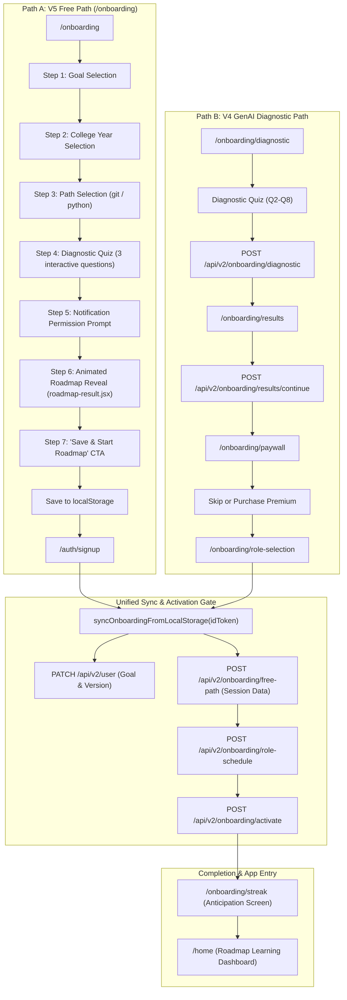

# Ignitio — End-to-End Onboarding Testing Specification

This document provides a comprehensive end-to-end testing specification for the entire Ignitio onboarding flow, detailing frontend routes, backend APIs, data synchronization, state transitions, error handling, and manual/automated test scenarios in accordance with [AGENTS.md]( ignitio-main-app/AGENTS.md).

---

## 1. System Architecture & Flow Overview

Ignitio has two distinct onboarding funnels that culminate in a unified activation and streak-initialization gateway:

1. **Path A — V5 Free Path (Instant Discovery)**: Designed for frictionless exploration before requiring authentication. Collects goal, college year, skill track, and quick diagnostics in `localStorage`, generates a custom animated roadmap, and defers auth until the final "Save & Start Roadmap" action.
2. **Path B — V4 GenAI Assessment Path (Deep Diagnostic)**: Designed for tailored internship preparation. Features an in-depth diagnostic quiz (Q2–Q8), proficiency evaluation, monetization/paywall decision, role selection, and custom schedule generation.



---

## 2. Route Inventory & Expected Behavior

### 2.1. Route: `/onboarding` (V5 Free Path)
* **Frontend Component**: [`FreeOnboarding.jsx`]( ignitio-main-app/features/onboarding/v5-freepath/free-path/FreeOnboarding.jsx)
* **Auth Requirement**: None (Public).
* **LocalStorage Keys Written**:
  * `ignitio:onboarding_result`: Stores user choices (`{ goal, year, path, roadmap, diagnosticResults, completedAt }`).
  * `ignitio:streak_lesson_href`: First lesson URL (e.g. `/home/roadmaps/git-github/interactive-overviews/first-overview`).
  * `ignitio:streak_phase`: `'anticipated'`.
* **Expected UI Behavior**:
  * Step progression smoothly updates progress indicators.
  * Quiz evaluates answers with micro-feedback without page reloads.
  * Displays [`roadmap-result.jsx`]( ignitio-main-app/components/roadmap/roadmap-result.jsx) with Kibo animated avatar, dynamic stages, lock status, and calculated duration in weeks.
  * Clicking **Save & Start Roadmap**:
    * If unauthenticated: redirects to `/auth/signup`.
    * If already authenticated: immediately derives schedule, flushes data to backend, calls activation, and navigates to `/onboarding/streak`.

---

### 2.2. Route: `/auth/signup` (Post-Auth Ingestion)
* **Frontend Component**: [`SignupForm.jsx`]( ignitio-main-app/features/auth/components/SignupForm.jsx)
* **Triggered APIs on Submission**:
  1. `POST /api/v2/user` → Creates user profile document with `{ onboardingVersion: "v5" }`.
  2. `syncOnboardingFromLocalStorage(idToken)`:
     * `PATCH /api/v2/user` → Synchronizes mapped goal (`internship_1_3_months`, `curiosity_general`, etc.).
     * `POST /api/v2/onboarding/free-path` → Persists year, path, roadmap, and diagnostic answers.
     * Clears synced keys from `localStorage`.
  3. `POST /api/v2/onboarding/role-schedule`:
     * Automatically derives schedule via `deriveScheduleFromBrowser()`.
     * Assigns `role: "student"` and 1-hour time window within the current period.
     * Transitions `onboardingState.step` to `"activation_pending"`.
  4. `POST /api/v2/onboarding/activate`:
     * Activates Foundation roadmap.
     * Initializes `streak.timezone` and `streak.onboardingStartDate`.
     * Updates `onboardingComplete: true` and `onboardingState.step: "completed"`.
* **Expected Navigation**:
  * Redirects to `/onboarding/streak` if `ignitio:streak_phase === 'anticipated'`; otherwise `/home`.

---

### 2.3. Route: `/onboarding/diagnostic` & `/onboarding/results` (V4 GenAI Flow)
* **Frontend Components**:
  * Diagnostic: [`page.js`]( ignitio-main-app/app/onboarding/%28v4-genai%29/diagnostic/page.js)
  * Results: [`DiagnosticResults.jsx`]( ignitio-main-app/features/onboarding/v4-genai/results/DiagnosticResults.jsx)
* **APIs**:
  * `POST /api/v2/onboarding/diagnostic`:
    * Evaluates answers Q2–Q8 using rule-based/grading logic.
    * Upserts `OnboardingResponseModel` (`onboardingVersion: "v4"`).
    * Moves `UserProfile.onboardingState.step` to `"results"`.
  * `GET /api/v2/onboarding/diagnostic/results`:
    * Returns proficiency metrics, strengths, and recommended focus areas.
  * `POST /api/v2/onboarding/results/continue`:
    * Advances `onboardingState.step` from `"results"` to `"paywall"`.
* **Expected Navigation**: Transitions to `/onboarding/paywall`.

---

### 2.4. Route: `/onboarding/paywall` (Monetization Gate)
* **Frontend Component**: [`Paywall.jsx`]( ignitio-main-app/features/onboarding/v4-genai/paywall/Paywall.jsx)
* **APIs**:
  * `GET /api/v2/onboarding/paywall/status` → Checks active subscription and entitlement.
  * `POST /api/v2/onboarding/paywall/skip` → Free path fallback; advances step to `"role_selection"`.
  * *Purchase Flow*: Razorpay checkout + webhook / `verifyPayment` sets `user.entitlements.roadmaps.genAi: true`.
* **Expected Navigation**: Routes to `/onboarding/role-selection`.

---

### 2.5. Route: `/onboarding/role-selection` (Core Role & Schedule)
* **Frontend Component**: [`RoleScheduleController.jsx`]( ignitio-main-app/features/onboarding/core/role-selection/RoleScheduleController.jsx)
* **API**: `POST /api/v2/onboarding/role-schedule`
* **Payload**:
  ```json
  {
    "role": "student",
    "schedule": {
      "timezone": "Asia/Kolkata",
      "windows": [
        {
          "period": "EVENING",
          "startTime": "18:00",
          "endTime": "19:00"
        }
      ]
    }
  }
  ```
* **Validation Rules**:
  * Role must be one of: `"student"`, `"engineer"`, `"researcher"`, `"founder"`.
  * Timezone must be a valid IANA identifier verified by `Intl.DateTimeFormat`.
  * Window must strictly fall within period boundary (`MORNING: 05:00-12:00`, `NOON: 12:00-17:00`, `EVENING: 17:00-21:00`, `NIGHT: 21:00-23:59`).
  * `endTime` must be strictly after `startTime`.
* **Database Updates**:
  * `user.role` updated.
  * `user.schedulePreference` updated (`isDefault: false`).
  * `user.onboardingState.step` set to `"activation_pending"`.
* **Expected Navigation**: Routes to `/onboarding/activation`.

---

### 2.6. Route: `/onboarding/activation` (Atomic Activation Engine)
* **Frontend Component**: [`ActivationPage`]( ignitio-main-app/app/onboarding/%28core%29/activation/page.js)
* **API**: `POST /api/v2/onboarding/activate`
* **Backend Processing** ([`activation.service.js`]( ignitio-main-app/lib/onboarding/activation.service.js)):
  * **State Guard**: Requires `user.onboardingState.step === "activation_pending"`. Returns `409 Conflict` if invalid.
  * **Prerequisites Guard**: Requires `user.role` and valid `schedulePreference`. Returns `422 Unprocessable Entity` if missing.
  * **Foundation Branch (`genAi !== true`)**:
    * Sets `onboardingComplete: true`.
    * Sets `onboardingState.step: "completed"`.
    * Sets `completedAt: now`.
    * Initializes `user.streak`:
      * `current: 0`, `longest: 0`, `lastActiveDate: null`
      * `timezone: schedulePref.timezone`
      * `onboardingStartDate: now`
  * **Premium Branch (`genAi === true`)**:
    * Reads `OnboardingResponseModel` (`v4`).
    * Reconstructs diagnostic answers and maps exclusions.
    * Runs `compileRoadmap()` against `RoadmapTemplate`.
    * Creates `RoadmapPersonalized` document.
    * Creates `RoadmapProgress` document (`status: "not_started"`).
    * Links `roadmapPersonalizationRef` to `UserProfile`.
    * Sets `onboardingComplete: true`, `onboardingState.step: "completed"`.
* **Idempotency**: Retrying with an already activated user returns `{ success: true, nextStep: "completed", alreadyActivated: true }` without crashing or creating duplicates.
* **Client Handshake**: Calls `mutateProfile()` to refresh SWR user profile, then transitions to `/home` or `/onboarding/streak`.

---

### 2.7. Route: `/onboarding/streak` (Streak Anticipation)
* **Frontend Component**: [`page.js`]( ignitio-main-app/app/onboarding/%28core%29/streak/page.js)
* **Expected Behavior**:
  * Calculates current 7-day week starting from current day.
  * Displays flame streak status with Day 1 anticipation.
  * Pulls lesson URL from `ignitio:streak_lesson_href` (e.g. `/home/roadmaps/git-github/interactive-overviews/first-overview`).
  * Action button directs user straight into the first roadmap lesson.

---

## 3. Root Cause Analysis: The 422 Activation Error

### Observed Log
```
○ Compiling /auth/signup ...
POST /api/v2/onboarding/activate 422 in 223ms
```

### Diagnostic Trace
1. In [`activation.shared.js`]( ignitio-main-app/lib/onboarding/activation.shared.js#L127-L157):
   ```javascript
   export function validateSharedPrerequisites(user) {
     if (!user.role) {
       return { ok: false, status: 422, error: "User role is required" };
     }
     const scheduleValidation = validateSchedulePreference(user.schedulePreference);
     if (!scheduleValidation.valid) {
       return { ok: false, status: 422, error: scheduleValidation.error };
     }
     return { ok: true };
   }
   ```
2. In [`FreeOnboarding.jsx`]( ignitio-main-app/features/onboarding/v5-freepath/free-path/FreeOnboarding.jsx#L282-L306):
   * `fetch("/api/v2/onboarding/role-schedule")` is called.
   * `fetch("/api/v2/onboarding/activate")` is immediately called without checking `if (!roleScheduleRes.ok)`.
3. In [`schedule-periods.js`]( ignitio-main-app/lib/onboarding/schedule-periods.js#L128-L165):
   * When `deriveScheduleFromBrowser()` runs near the end of a time window (e.g., 16:50 in NOON, max 17:00), `rawEndMins` is clamped to `maxMins`.
   * If `startMins >= maxMins`, `startTime === endTime`, causing `role-schedule` to reject with a 400 validation error (`endTime must be after startTime`).
   * Because `role-schedule` failed to write `role` and `schedulePreference` to MongoDB, the subsequent call to `/activate` encountered an empty role/schedule and rejected with **422 Unprocessable Entity**.

### Resolution Protocol (Per AGENTS.md Safe Rules)
1. In `deriveScheduleFromBrowser()`: Ensure a minimum 15-minute buffer is maintained, rolling over to the next period if less than 15 minutes remains in the current period.
2. In `FreeOnboarding.jsx`: Verify `roleScheduleRes.ok` before triggering `/api/v2/onboarding/activate`.

---

## 4. End-to-End Test Matrix & Verification Checklist

| Test ID | Test Scenario | Steps | Expected Result | Invariant Verified |
| :--- | :--- | :--- | :--- | :--- |
| **TC-01** | **V5 Free Path Pre-Auth Exploration** | 1. Open incognito window.<br>2. Visit `/onboarding`.<br>3. Pick Goal -> Year -> Path -> Complete 3 quiz questions.<br>4. Inspect `localStorage`. | - Animated roadmap renders with correct weeks.<br>- `ignitio:onboarding_result` contains selections.<br>- `ignitio:streak_lesson_href` points to selected track lesson.<br>- No API calls to MongoDB yet. | Client state decoupled from auth before completion gate. |
| **TC-02** | **New User Signup & Auto-Activation** | 1. From `/onboarding`, click "Save & Start Roadmap".<br>2. Fill `/auth/signup` with fresh email & password.<br>3. Submit form. | - `POST /api/v2/user` returns 201.<br>- `PATCH /api/v2/user` sets goal.<br>- `POST /api/v2/onboarding/free-path` returns 200.<br>- `POST /api/v2/onboarding/role-schedule` returns 200.<br>- `POST /api/v2/onboarding/activate` returns 200 (`nextStep: "completed"`).<br>- User lands on `/onboarding/streak`. | `onboardingComplete: true`, `onboardingVersion: "v5"`, streak initialized. |
| **TC-03** | **Streak Anticipation Screen Rendering** | 1. Follow TC-02.<br>2. Observe `/onboarding/streak`.<br>3. Click "Start Lesson 1" CTA. | - 7-day schedule renders starting with today's day-of-week.<br>- Lesson button navigates directly to the first interactive lesson. | Preserves user motivation without routing stalls. |
| **TC-04** | **Completed User Route Guarding** | 1. Log in as an activated user.<br>2. Attempt visiting `/onboarding`.<br>3. Attempt visiting `/onboarding/activation`. | - `isOnboardingComplete(profile)` returns `true`.<br>- User is redirected to `/home`.<br>- State cannot regress backward. | Idempotent routing protection; completed state is immutable. |
| **TC-05** | **V4 Diagnostic Assessment Flow** | 1. Log in as a new user with `onboardingVersion: "v4"`.<br>2. Visit `/onboarding/diagnostic`.<br>3. Complete diagnostic questions. | - `POST /api/v2/onboarding/diagnostic` returns 200.<br>- `OnboardingResponseModel` saved.<br>- `onboardingState.step` transitions to `"results"`. | Diagnostic grades stored correctly. |
| **TC-06** | **V4 Results to Paywall Transition** | 1. Land on `/onboarding/results`.<br>2. Click "Continue to Plan". | - `GET /api/v2/onboarding/diagnostic/results` provides analysis.<br>- `POST /api/v2/onboarding/results/continue` updates step to `"paywall"`.<br>- User arrives at `/onboarding/paywall`. | State progression through Results stage verified. |
| **TC-07** | **V4 Paywall Skip & Role Selection** | 1. Land on `/onboarding/paywall`.<br>2. Click "Continue with Foundation (Free)".<br>3. Pick role and schedule at `/onboarding/role-selection`. | - `POST /api/v2/onboarding/paywall/skip` returns 200.<br>- `POST /api/v2/onboarding/role-schedule` returns 200.<br>- `onboardingState.step` set to `"activation_pending"`.<br>- Routes to `/onboarding/activation`. | Role and schedule saved with strict time validations. |
| **TC-08** | **Activation Service State Guard** | 1. Call `POST /api/v2/onboarding/activate` while user is in step `"role_selection"` (not `"activation_pending"`). | - Server returns `409 Conflict` (`"Invalid onboarding state"`).<br>- No database modifications made. | Prevents jumping steps or out-of-order execution. |
| **TC-09** | **Activation Service Prerequisite Guard** | 1. Manually clear user's `role` or `schedulePreference` while in step `"activation_pending"`.<br>2. Call `POST /api/v2/onboarding/activate`. | - Server returns `422 Unprocessable Entity` (`"User role is required"`).<br>- No incomplete activation written. | Prevents corrupted profiles without roles/schedules. |
| **TC-10** | **Activation Idempotency & Re-entry** | 1. For a user who already completed activation (`onboardingState.step: "completed"`), send repeated `POST /api/v2/onboarding/activate` calls. | - Server returns `{ success: true, nextStep: "completed", alreadyActivated: true }` with status 200.<br>- Streak start date and counters are preserved without resetting. | Safe against network retry loops and double-clicks. |

---

## 5. Automated Verification Script

A verification script can be executed against your local Next.js API server to test the entire lifecycle:

```bash
# Ensure dev server is running on port 5000:
npm run dev

# Run state verification against MongoDB:
node scripts/check-user-state.mjs <firebaseUID>
```

---

## 6. Summary of Architectural Guarantees (AGENTS.md Compliance)

1. **Role Boundary**: `user.role` affects contextual AI framing (e.g., Kyle persona), but does **not** alter the core curriculum requirements.
2. **Data Structure Integrity**: `UserProfile`, `OnboardingResponseModel`, `RoadmapPersonalized`, and `RoadmapProgress` retain strict separation between Foundation and GenAI Premium tiers.
3. **Immutability of State**: React state mutations throughout the onboarding flow avoid in-place array/object mutations.
4. **Resilience**: Pre-auth selections survive page reloads and browser crashes via resilient `localStorage` staging and one-shot flush upon authentication.
